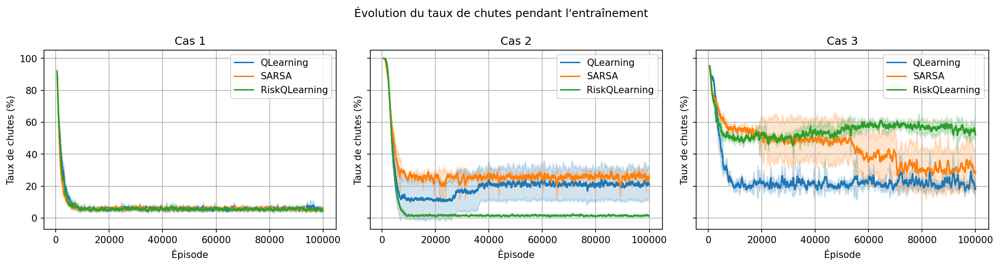
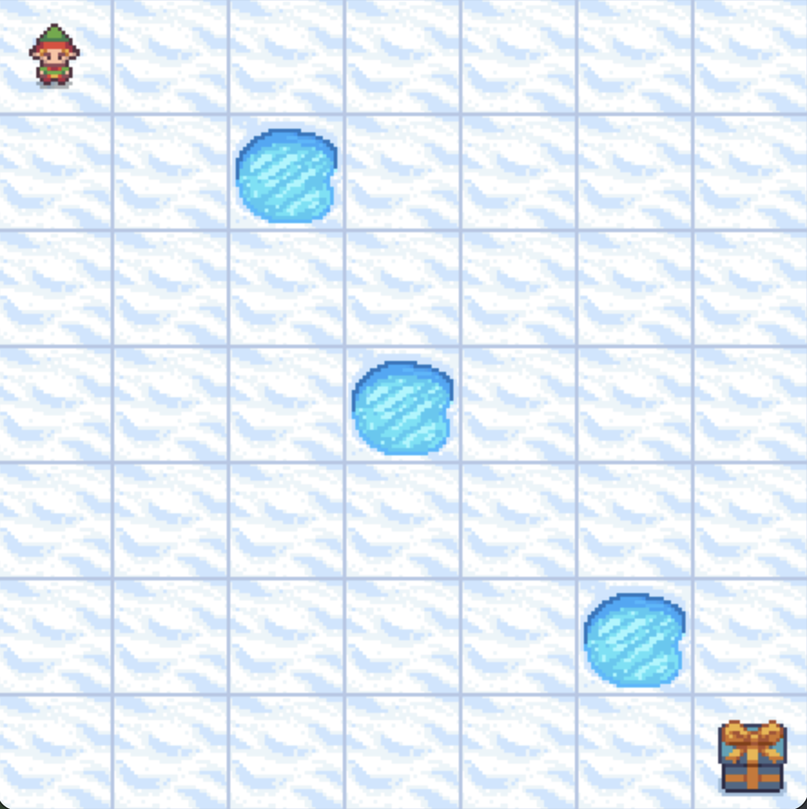
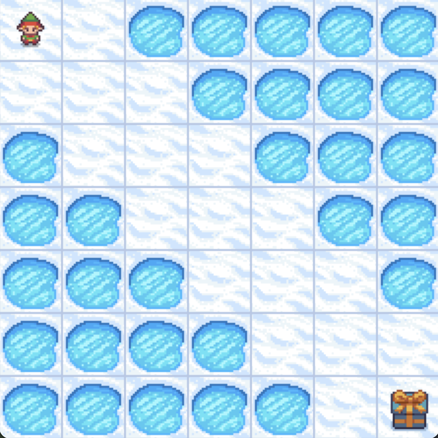
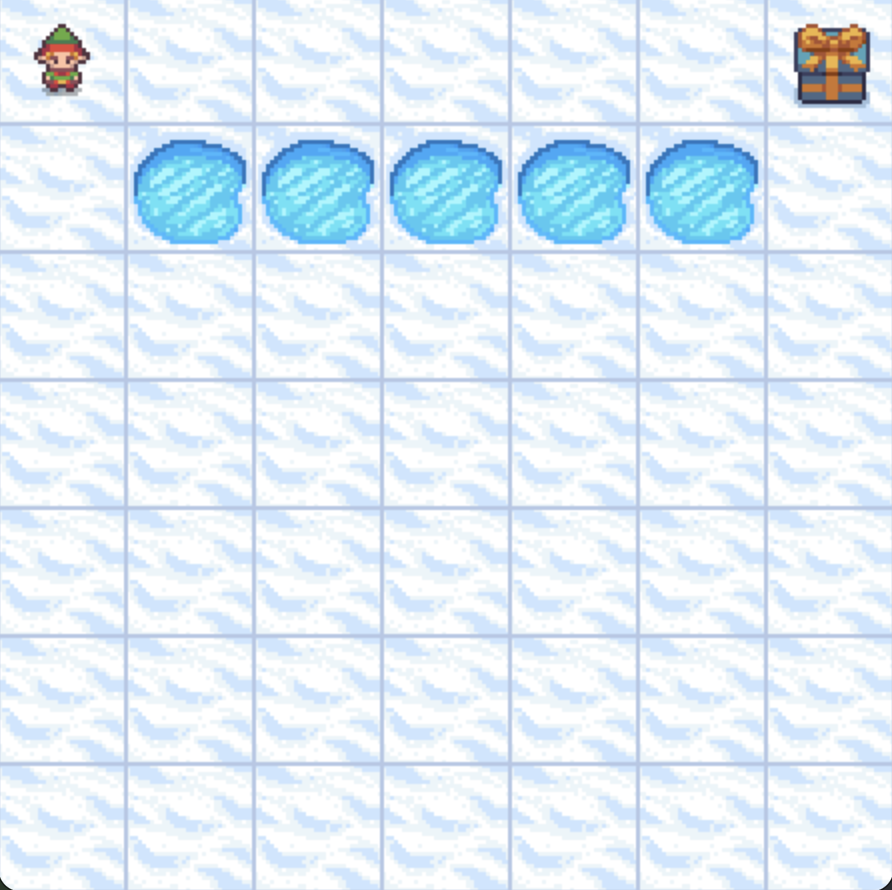

# Risk-sensitive Q-learning on a slippery FrozenLake

Can an agent fall into fewer holes *while it learns*, not just once it has learned? We compared Q-learning, SARSA and risk-sensitive Q-learning (Mihatsch & Neuneier, 2002) on three slippery FrozenLake maps, each built to stress a different trade-off.

Course project for IFT-7201 (Reinforcement Learning, Université Laval), with [Rémi Hercouet](https://github.com/Yaienex). Full report: [`report/report.pdf`](report/report.pdf).



## Results

| 1. Efficiency | 2. Narrow corridor | 3. Risk vs reward |
|:---:|:---:|:---:|
|  |  |  |
| Three scattered holes | A diagonal corridor between holes | A short path along the holes, or a long safe detour |

Each run: 100,000 training episodes, then 1,000 greedy evaluation episodes. Mean over 5 seeds.

| Map | Strategy | Success (eval) | Falls (eval) | Falls during training (seed 0) |
|---|---|---:|---:|---:|
| 1. Efficiency | Q-learning | 95.5% | 4.2% | 7,556 |
| | SARSA | 94.7% | 5.3% | 7,129 |
| | Risk-sensitive | 94.7% | 5.3% | 7,020 |
| 2. Narrow corridor | Q-learning | 56.1% | 17.2% | 29,191 |
| | SARSA | 61.3% | 18.4% | 28,296 |
| | Risk-sensitive | 0.1% | 0.1% | **5,218** |
| 3. Risk vs reward | Q-learning | 82.1% | 17.8% | 25,612 |
| | SARSA | 76.2% | 23.7% | 47,860 |
| | Risk-sensitive | 46.1% | 53.9% | 56,675 |

**What it shows**

- **Map 1.** On an easy map the three agents end up the same, around 95% success.
- **Map 2.** The risk-sensitive agent falls five times less during training. But its final policy almost never moves: 0.1% falls, 0.1% success. It became so averse to holes that it stopped crossing.
- **Map 3.** When speed and safety have to be traded off, the same agent does worst: it falls more than both baselines, during training and after. Overweighting bad surprises distorts its value estimates instead of making it careful.

## Method

- Environment: Gymnasium FrozenLake v1, slippery, with three custom maps and reward schemes (`src/generate_case_study.py`).
- Risk-sensitive Q-learning: negative TD errors are weighted 1.5×, positive ones 0.5× (κ = −0.5 in `src/experiment.py`).
- Shared settings: α = 0.1, γ = 0.99, ε decays from 1.0 to 0.01.

## Run it

Python 3.12 (pygame cannot load PNGs on 3.14).

```bash
python3.12 -m venv .venv && source .venv/bin/activate
pip install -r requirements.txt
cd src
python experiment.py   # 3 strategies × 3 maps × 5 seeds
python graphique.py    # figures
```
